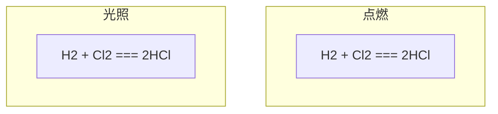
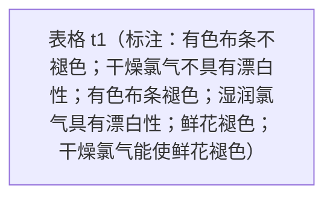

# 2.2.1氯气 第一课时.pptx

共 15 页。每页“内容”为原生文字、表格和图表数据；“结构”只记录可确定的关系。

坐标单位为页面像素，原点在左上；页面右下为 1280,720。

## 第 1 页

### 内容

**c2**（左上 146,136；右下 1132,430）

第二章 海水中的重要元素——钠和氯

第一节 氯及其化合物

（第一课时）

**c1**（左上 418,543；右下 1238,603）

瑞昌一中高一年级化学备课组

## 第 2 页

### 内容

**c1**（左上 68,156；右下 421,264）

学习目标

**c2**（左上 68,264；右下 1279,541）

1\. 通过实验探究氯气的化学性质，培养证据推理意识。

2\. 从氧化还原反应、离子反应角度认识氯气的性质，并能用化学方程式正确表达。

## 第 3 页

### 内容

**c1**（左上 8,61；右下 1285,224）

阅读P_(44)第1段并思考：1、氯在自然界中以什么形式存在？ 2、生活中有哪些含氯的物质？3、氯气有哪些重要的用途？

**c7**（左上 13,204；右下 454,292）

一、氯的存在

**c2**（左上 28,270；右下 1280,405）

1、氯是一种重要的“成盐元素”，在自然界中以化合态的形式存在。 主要以NaCl、MgCl_(2)、CaCl_(2)等形式存在于海水中，还存在于陆地的盐湖和盐矿中。

**c6**（左上 28,408；右下 263,519）

2、生活中含

&#32;&#32;&#32;&#32;&#32;&#32;氯的物质

**c4**（左上 938,417；右下 1066,482）

NaClO

**c5**（左上 341,431；右下 415,496）

HCl

**c3**（左上 688,500；右下 843,564）

Ca(ClO)_(2)

**c8**（左上 13,595；右下 1280,705）

3、氯气的用途：是一种重要的化工原料,大量用于制造盐酸、有机溶剂、农药、染料和药品等

## 第 4 页

### 内容

**c1**（左上 10,61；右下 1170,168）

二、氯的发现与命名

**c2**（左上 341,152；右下 1206,400）

18世纪70年代，瑞典化学家舍勒将软锰矿与浓盐酸混合加热，产生了一种黄绿色、有刺激性气味的气体。受当时流行学说的影响，舍勒未能确认这种气体。

**c4**（左上 94,366；右下 361,435）

瑞典化学家舍勒

**c3**（左上 341,454；右下 1108,589）

直到1810年，英国化学家戴维才确认这种气体是一种新元素组成的单质——氯气。

**c5**（左上 97,633；右下 361,701）

英国化学家戴维

## 第 5 页

### 内容

**c1**（左上 0,74；右下 316,143）

思考与交流

**c2**（左上 53,157；右下 1258,354）

&#32;&#32;&#32;&#32;从氯气的发现(1774年舍勒)到氯被认为是一种新元素(1810年戴维)，时间长达三十多年，其间经历了数位科学家的不懈探索。我们从这一史实中得到什么启示呢？

**c3**（左上 67,368；右下 1184,685）

1.科学研究需要有正的理论作指导，错误的理论只能浪费时间和精力

2.科学研究需要以大量事实为依据，只有大量事实才能推翻错误的理论，建立正的理论或推动科学理论的发展。

3.科学研究需要有热爱科学的思想和为科学献身的精神。

## 第 6 页

### 内容

**c1**（左上 -7,89；右下 547,151）

（一）氯气的物理性质

**c17**（左上 598,89；右下 928,160）

闻气体的方法？

**c9**（左上 210,137；右下 329,203）

气体

**c8**（左上 3,137；右下 169,198）

状态

**c10**（左上 210,197；右下 365,264）

黄绿色

**c2**（左上 3,204；右下 168,266）

颜色

**c11**（左上 210,270；右下 474,336）

有刺激性气味

**c3**（左上 3,272；右下 169,333）

气味

**c12**（左上 210,338；右下 329,405）

有毒

**c5**（左上 3,344；右下 168,405）

毒性

**c13**（左上 210,406；右下 797,473）

密度比空气大——向上排空气法

**c4**（左上 3,413；右下 169,474）

密度

**c16**（左上 837,435；右下 1017,486）

混合物

**c6**（左上 3,495；右下 168,556）

溶解性

**c14**（左上 188,496；右下 1280,562）

能溶于水（1体积水能溶2体积的氯气，氯水——浅黄绿色）

**c15**（左上 186,571；右下 1210,636）

易液化，在低温加压条件下易转变成液氯，储存在钢瓶中

**c7**（左上 3,574；右下 169,635）

特性

**c18**（左上 754,653；右下 897,705）

纯净物

## 第 7 页

### 内容

**c3**（左上 8,75；右下 533,140）

（二）氯气的化学性质

**c1**（左上 118,175；右下 967,228）

从原子结构的角度分析氯的基本性质：

**c8**（左上 187,273；右下 245,339）

Cl

**c13**（左上 655,274；右下 720,340）

Cl^(-)

**c2**（左上 370,321；右下 606,413）

最外层得到

1个电子

**c5**（左上 184,333；右下 264,411）

+17

**c10**（左上 638,335；右下 722,412）

+17

**c12**（左上 758,354；右下 790,385）

8

**c9**（左上 787,354；右下 820,385）

8

**c11**（左上 729,355；右下 762,386）

2

**c4**（左上 338,356；右下 368,387）

7

**c7**（左上 304,357；右下 334,388）

8

**c6**（左上 271,357；右下 302,388）

2

**c14**（左上 0,535；右下 1280,676）

结构决定性质：容易得到1个电子，表现出较强的氧化性。

&#32;&#32;&#32;&#32;&#32;&#32;&#32;&#32;&#32;&#32;&#32;&#32;&#32;&#32;&#32;在自然界中氯元素均以化合态存在。

## 第 8 页

### 内容

**c1**（左上 6,77；右下 492,141）

1.氯气与金属单质的反应

**c7**（左上 670,101；右下 1132,316）

思考： FeCl_(3)和CuCl_(2)能用它们的金属与盐酸反应制取吗？

**c3**（左上 70,118；右下 1210,249）

&#32;&#32;氯气能与大多数金属化合生成金属氯化物，如果金属有变价，一般得到高价态氯化物

**c2**（左上 68,477；右下 451,582）

剧烈燃烧，火焰呈黄色，产生大量白烟

**c5**（左上 934,621；右下 1184,683）

（棕黄色烟）

**c6**（左上 584,621；右下 838,683）

（棕褐色烟）

**c4**（左上 239,640；右下 420,702）

（白烟）

## 第 9 页

### 内容

**c1**（左上 13,61；右下 1044,306）

\[例1\]下列各化合物不能由单质直接化合制取的是（       ）

&#32;&#32;&#32;&#32;&#32;&#32;&#32;&#32;&#32;&#32;&#32;A. FeCl_(3)  		        B. CuCl_(2)

&#32;&#32;&#32;&#32;&#32;&#32;&#32;&#32;&#32;&#32;&#32;C. AlCl_(3)  		        D. FeCl_(2)

**c2**（左上 855,61；右下 954,165）

D

**c4**（左上 995,319；右下 1267,419）

AD

**c3**（左上 13,337；右下 1156,547）

\[例2\]（双选）不能用金属单质和稀盐酸反应制得的物质是（         ）

&#32;&#32;&#32;&#32;&#32;&#32;&#32;&#32;&#32;&#32;&#32;A、FeCl_(3 )                     B、AlCl_(3)

&#32;&#32;&#32;&#32;&#32;&#32;&#32;&#32;&#32;&#32;&#32;C、FeCl_(2)                      D、CuCl_(2)

**c5**（左上 32,578；右下 1267,641）

注意：氯气有氧化性，能够氧化Fe^(2+)、Br^(—)、I^(—  )等，请写出离子方程式

## 第 10 页

### 内容

**c8**（左上 -40,73；右下 542,134）

2.氯气与非金属单质的反应

**c7**（左上 42,134；右下 404,252）

氯气与H_(2)反应实验

**c1**（左上 32,247；右下 1280,366）

实验现象1：纯净的H_(2)在Cl_(2)中安静地燃烧，发出苍白色火焰，瓶口有白雾。

**c3**（左上 283,319；右下 410,387）

点燃

**c2**（左上 119,338；右下 574,424）

H_(2 )+ Cl_(2 )=== 2HCl

**c5**（左上 301,427；右下 404,496）

光照

**c4**（左上 121,445；右下 529,531）

H_(2) + Cl_(2 )=== 2HCl

**c6**（左上 57,557；右下 617,675）

实验现象2：剧烈反应，发生爆炸。

### 结构

## 第 11 页

### 内容

**c1**（左上 20,73；右下 1280,208）

&#32;通过Na、Fe、Cu、H_(2)在氯气中燃烧，对燃烧的条件与本质有什么新的认识？

**c2**（左上 100,146；右下 1061,394）

①燃烧不一定需要氧气。

②燃烧的本质是还原剂(可燃物)与氧化剂(助燃剂)之间的

&#32;&#32;&#32;剧烈的发光发热的氧化还原反应。

**c3**（左上 40,433；右下 1260,621）

1.下列说法中，不正确的是（  ）

&#32;&#32;A.燃烧一定伴有发光现象     B.燃烧一定是氧化还原反应

&#32;&#32;C.燃烧一定要有氧气参加     D.燃烧一定会放出热量

**c4**（左上 540,445；右下 595,518）

C

## 第 12 页

### 内容

**c8**（左上 20,81；右下 1280,182）

在25℃时，1体积的水可溶解2体积的氯气，氯气的水溶液称为氯水。氯气溶于水为什么能杀菌、消毒呢？

**c1**（左上 929,196；右下 1203,254）

浅黄绿色

**c7**（左上 -105,208；右下 477,269）

2.氯气与水的反应

**c2**（左上 318,303；右下 859,358）

&#32;

**c3**（左上 73,305；右下 299,415）

化学方程式：

**c5**（左上 326,380；右下 867,442）

&#32;

**c4**（左上 73,387；右下 325,462）

离子方程式：

**c6**（左上 47,508；右下 1187,680）

氯气会与水中生成HClO，HClO有强氧化性，能给自来水消毒，但氯气会与水中有机物发生反应，产生的有机氯化物对人体有害。现用二氧化氯(ClO_(2))、臭氧(O_(3))等。

## 第 13 页

### 内容

**c1**（左上 42,58；右下 257,132）

实验2-8

**t1**（左上 51,139；右下 1248,534） （3 行 × 4 列）

|  | C1 | C2 | C3 | C4 |
| --- | --- | --- | --- | --- |
| R1 | 实验操作 |  |  |  |
| R2 | 实验现象 |  |  |  |
| R3 | 实验结论 |  |  |  |

**c6**（左上 889,350；右下 1182,432）

鲜花褪色

**c4**（左上 507,352；右下 801,433）

有色布条褪色

**c2**（左上 200,353；右下 503,438）

有色布条不褪色

**c3**（左上 209,435；右下 489,546）

干燥氯气不具有漂白性

**c5**（左上 477,442；右下 828,528）

湿润氯气具有漂白性

**c7**（左上 849,442；右下 1222,528）

干燥氯气能使鲜花褪色

**c8**（左上 0,546；右下 1280,683）

褪色原因：使有色物质褪色的物质不是氯气本身，而是氯气与水反应生成的HClO具有漂白性。

### 结构

## 第 14 页

### 内容

**c2**（左上 -10,101；右下 363,185）

✪ 氯水的漂白性

**c1**（左上 24,194；右下 1277,426）

- n 次氯酸具有强氧化性，能将有色物质氧化成无色物质，还能使某些染料和有机色素褪色，可以用作棉、麻和纸张的漂白剂。

**c3**（左上 57,434；右下 1201,668）

①向紫色石蕊溶液中通入过量的氯气， 现象为：溶液先变红 ，

&#32;后褪色。

②由于次氯酸具有漂白性， 故不能用pH试纸测定氯水的pH。

## 第 15 页

### 内容

**c1**（左上 47,108；右下 1264,547）

\[例3\]用胶头滴管将新制的饱和氯水慢慢滴入含有酚酞的氢氧化钠稀溶液中，当滴到一定量时，红色突然褪去。试回答下列问题。

(1) 产生上述现象的原因可能有两种：

(2) 怎样用实验证明红色褪去的原因是①或②?

**c2**（左上 108,313；右下 1204,427）

- 1 氯水中含有强氧化性的HClO，它的漂白作用能使红色褪去。
- 2 氯水中含有H^(+)，能中和OH^(—)，使酚酞褪色。

**c3**（左上 118,547；右下 1192,661）

可通过向褪色后的溶液中再加入足量的NaOH溶液，看溶液是否重新变成红色来验证溶液褪色的原因。
