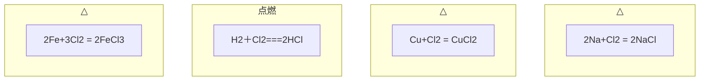
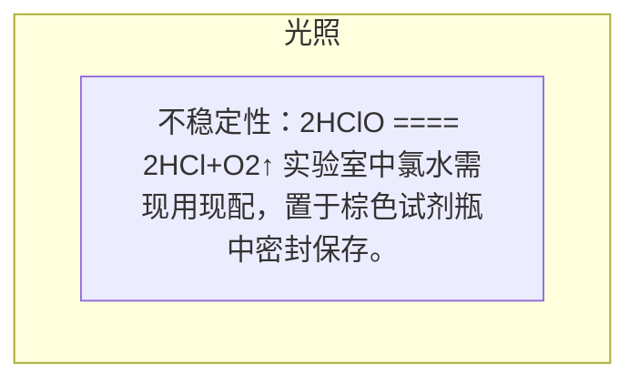
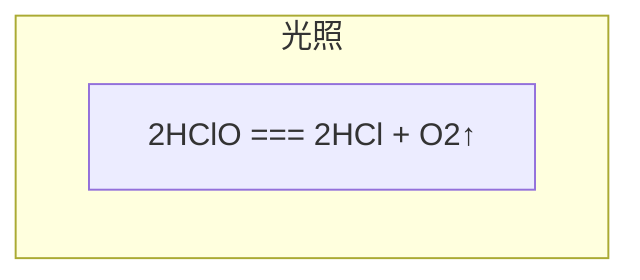
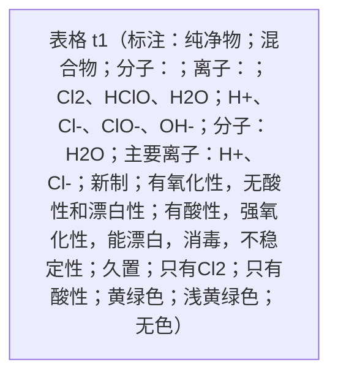
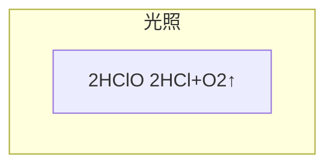

# 2.2.2氯气 第二课时.pptx

共 12 页。每页“内容”为原生文字、表格和图表数据；“结构”只记录可确定的关系。

坐标单位为页面像素，原点在左上；页面右下为 1280,720。

## 第 1 页

### 内容

**c2**（左上 146,136；右下 1132,430）

第二章 海水中的重要元素——钠和氯

第二节  氯及其化合物

（第二课时）

**c1**（左上 396,518；右下 1215,578）

瑞昌一中高一年级化学备课组

## 第 2 页

### 内容

**c1**（左上 68,156；右下 421,264）

学习目标

**c2**（左上 68,264；右下 1279,541）

1\. 通过实验探究氯气的化学性质，培养证据推理意识。

2\. 从氧化还原反应、离子反应角度认识氯气与碱反应，了解漂白粉、漂白液。

## 第 3 页

### 内容

**c17**（左上 47,44；右下 284,151）

温故知新

**c19**（左上 999,45；右下 1274,104）

浅黄绿色

**c1**（左上 34,124；右下 457,231）

氯气的化学性质：

**c2**（左上 54,231；右下 571,306）

（1）与金属单质反应

**c11**（左上 457,240；右下 1100,350）

（铁丝剧烈燃烧，产生棕褐色的烟）

**c14**（左上 656,286；右下 743,361）

△

**c4**（左上 256,290；右下 346,364）

△

**c6**（左上 1076,290；右下 1165,365）

△

**c5**（左上 951,298；右下 1322,373）

Cu+Cl_(2) = CuCl_(2)

**c3**（左上 113,298；右下 509,373）

2Na+Cl_(2) = 2NaCl

**c13**（左上 504,298；右下 856,373）

2Fe+3Cl_(2) = 2FeCl_(3)

**c12**（左上 697,356；右下 1325,431）

（产生棕黄色的烟,溶液呈蓝绿色）

**c10**（左上 65,367；右下 620,442）

(火焰呈黄色，生成白色晶体 )

**c9**（左上 623,431；右下 717,487）

点燃

**c8**（左上 491,440；右下 802,515）

H_(2)＋Cl_(2)===2HCl

**c7**（左上 47,444；右下 552,519）

（2）与非金属单质反应

**c16**（左上 430,519；右下 971,574）

&#32;

**c15**（左上 54,524；右下 559,599）

（3）与水反应

**c20**（左上 698,579；右下 1324,689）

Cl_(2) 、H_(2)O 、HClO 、 

H^(+) 、Cl^(-) 、ClO^(-)、OH^(- )

**c18**（左上 47,599；右下 679,674）

思考：新制氯水中含有哪些微粒？

### 结构

## 第 4 页

### 内容

**c1**（左上 16,95；右下 388,180）

✪ 次氯酸的性质

**c6**（左上 478,165；右下 1245,344）

强氧化性：①杀菌、消毒；②能将某些有机色素氧化成无色物质，可以用作棉、麻和纸张的漂白剂。

**c2**（左上 48,369；右下 258,501）

HClO

**c3**（左上 478,373；右下 1245,441）

弱酸性：醋酸 \> 碳酸 \> 次氯酸

**c5**（左上 825,442；右下 925,507）

光照

**c4**（左上 478,472；右下 1245,661）

不稳定性：2HClO ==== 2HCl+O_(2)↑

实验室中氯水需现用现配，置于棕色试剂瓶中密封保存。

### 结构

## 第 5 页

### 内容

**c3**（左上 129,8；右下 329,73）

导学自学

**c1**（左上 44,76；右下 1186,178）

阅读P_(48 )科学、技术、社会

**c4**（左上 169,144；右下 990,231）

探究氯水久置会发生什么变化？

**c6**（左上 453,548；右下 541,607）

光照

**c5**（左上 338,559；右下 936,631）

2HClO === 2HCl + O_(2)↑

**c2**（左上 904,662；右下 1212,720）

25

### 结构

## 第 6 页

### 内容

**c15**（左上 68,95；右下 886,166）

比较液氯、新制氯水和久置氯水的区别

**t1**（左上 77,168；右下 1196,678） （6 行 × 4 列）

|  | C1 | C2 | C3 | C4 |
| --- | --- | --- | --- | --- |
| R1 |  | 液氯 | 氯水 | 并入 R1C3 |
| R2 | 分类 |  |  | 并入 R2C3 |
| R3 | 并入 R2C1 | 并入 R2C2 |  |  |
| R4 | 成分 |  | \n\n\u0020 |  |
| R5 | 颜色 |  |  |  |
| R6 | 性质 |  |  |  |

合并：R1C3 跨 1 行 2 列；R2C1 跨 2 行 1 列；R2C2 跨 2 行 1 列；R2C3 跨 1 行 2 列。

**c2**（左上 725,230；右下 886,302）

混合物

**c1**（左上 233,257；右下 381,328）

纯净物

**c9**（左上 603,289；右下 720,361）

新制

**c12**（左上 928,289；右下 1062,361）

久置

**c5**（左上 533,357；右下 839,429）

Cl_(2)、HClO、H_(2)O

**c7**（左上 857,358；右下 1133,430）

分子：H_(2)O

**c3**（左上 433,361；右下 573,432）

分子：

**c13**（左上 225,403；右下 389,474）

只有Cl_(2)

**c6**（左上 529,415；右下 890,486）

H^(+)、Cl^(-)、ClO^(-)、OH^(-)

**c8**（左上 857,416；右下 1237,488）

主要离子：H^(+)、Cl^(-)

**c4**（左上 434,418；右下 573,489）

离子：

**c16**（左上 205,514；右下 409,585）

黄绿色

**c17**（左上 527,514；右下 746,585）

浅黄绿色

**c18**（左上 946,514；右下 1094,586）

无色

**c10**（左上 179,585；右下 435,699）

有氧化性，无酸性和漂白性

**c11**（左上 442,586；右下 881,700）

有酸性，强氧化性，能漂白，消毒，不稳定性

**c14**（左上 914,607；右下 1127,679）

只有酸性

### 结构

## 第 7 页

### 内容

**c1**（左上 0,61；右下 1285,362）

\[练习\]为探究氯水中含有的部分粒子及某些粒子的性质，某化学兴趣小组做了如下实验：

(1)观察氯水颜色，发现氯水呈浅黄绿色，证明氯水中含有的粒子是\_\_\_\_\_\_(填化学式，下同)。

(2)向氯水中滴入碳酸钠溶液，有气体生成，说明氯水中含有的粒子是\_\_\_\_\_\_\_\_\_\_。

(3)在盛有氯水的试管中的有色布条褪色，说明氯水中含有的粒子是\_\_\_\_\_\_\_\_\_。

**c3**（左上 944,129；右下 1123,213）

Cl_(2)

**c4**（左上 1012,197；右下 1139,309）

H^(+)

**c5**（左上 944,263；右下 1183,375）

HClO

**c6**（左上 965,345；右下 1078,430）

H^(+)

**c2**（左上 0,345；右下 1246,696）

(4)将紫色石蕊溶液滴入新制氯水中，溶液显红色，起作用的微粒是\_\_\_\_\_\_\_，过一会儿，溶液的颜色褪去，起作用的微粒是\_\_\_\_\_\_\_\_。

(5)向氯水中滴加AgNO_(3)溶液有白色沉淀生成，证明氯水中含有的粒子是\_\_\_\_\_\_\_\_。

(6)氯水经光照后，颜色逐渐消失，并放出的气体是\_\_\_\_\_\_，溶液的酸性\_\_\_\_\_\_\_(填“增强”“不变”或“减弱”)

(7)将Cl_(2)通入水中，溶液中具有氧化性的微粒是\_\_\_\_\_\_\_\_\_\_\_\_\_\_\_\_\_\_\_。

**c7**（左上 547,375；右下 786,487）

HClO

**c8**（左上 1023,425；右下 1203,537）

Cl^(—)

**c9**（左上 731,482；右下 844,594）

O_(2)

**c10**（左上 1005,495；右下 1162,602）

增强

**c11**（左上 670,587；右下 1098,789）

Cl_(2)、ClO^(—)、HClO

## 第 8 页

### 内容

**c3**（左上 16,65；右下 737,168）

阅读P_(47)“3、与碱反应”并思考：

**c2**（左上 0,132；右下 950,220）

1、为什么要将氯气制成漂白粉和消毒液？

**c1**（左上 45,200；右下 1246,368）

氯气在水中的溶解度不大，而且生成的HClO不稳定，难以保存，使用起来很不方便，效果也不理想。常制成漂白粉（Ca(ClO)_(2)）和漂白液（NaClO）。

## 第 9 页

### 内容

**c3**（左上 36,36；右下 1157,184）

2、氯气制消毒液反应原理是什么？漂白液漂白原理是什么？

&#32;&#32;&#32;&#32;&#32;&#32;标出反应的电子转移情况，并将反应改成离子方程式。

**c11**（左上 720,173；右下 873,231）

有效成分

**c1**（左上 240,241；右下 1023,312）

&#32;&#32;Cl_(2 )+ 2NaOH === NaCl  +  NaClO + H_(2)O

**c8**（左上 156,241；右下 816,312）

原理：

**c2**（左上 499,308；右下 864,380）

84消毒液的主要成分

**c6**（左上 322,390；右下 1106,462）

Cl_(2 )+ 2NaOH === NaCl  +  NaClO + H_(2)O

**c4**（左上 156,391；右下 342,463）

双线桥：

**c7**（左上 364,472；右下 1231,543）

&#32;Cl_(2 )+ 2OH^(-) === Cl^(-  )+  ClO^(-) + H_(2)O

**c5**（左上 156,474；右下 404,546）

离子方程式：

**c9**（左上 156,553；右下 497,625）

漂白液的漂白原理：

**c10**（左上 477,553；右下 1137,625）

NaClO + CO_(2) +H_(2)O === NaHCO_(3) +HClO

## 第 10 页

### 内容

**c5**（左上 58,92；右下 1161,242）

3、氯气制漂白粉反应原理是什么？漂泊粉漂白原理是什么？

&#32;&#32;&#32;&#32;&#32;&#32;漂白粉保存时注意什么？

**c4**（左上 760,189；右下 913,247）

有效成分

**c1**（左上 283,242；右下 1068,314）

&#32;&#32;2Cl_(2 )+ 2Ca(OH)_(2) === CaCl_(2 )+ Ca(ClO)_(2) + 2H_(2)O

**c6**（左上 125,242；右下 338,314）

制备原理：

**c2**（左上 256,308；右下 607,379）

氯气通入冷的石灰乳

**c3**（左上 619,318；右下 1017,389）

漂白粉的主要成分

**c7**（左上 56,388；右下 407,459）

漂白粉的漂白原理：

**c8**（左上 256,439；右下 1002,511）

Ca(ClO)_(2) + CO_(2) + H_(2)O  === CaCO_(3)↓ + 2HClO

**c10**（左上 587,520；右下 1333,591）

Ca(ClO)_(2) + CO_(2) + H_(2)O  === CaCO_(3)↓ + 2HClO

**c9**（左上 6,524；右下 666,596）

漂白粉长期露置在空气中失效的原因：

**c12**（左上 925,561；右下 1063,623）

光照

**c11**（左上 812,567；右下 1181,660）

2HClO        2HCl+O_(2)↑

**c13**（左上 178,588；右下 494,660）

密封、干燥、避光

### 结构

## 第 11 页

### 内容

**c1**（左上 12,90；右下 1280,331）

1\.　在抗震救灾中要用大量漂白粉和漂白液杀菌消毒。下列说法中正确的是（    ）

A.漂白粉是纯净物，漂白液是混合物                    B.漂白粉的有效成分是Ca(ClO)_(2)

C.工业上将氯气通入澄清石灰水制取漂白粉          D.漂白液的有效成分是Na_(2)O_(2)

**c2**（左上 1188,104；右下 1235,177）

B

**c3**（左上 12,331；右下 1323,703）

2.用漂白粉溶液浸泡过的有色布条晾置在空气中一段时间，漂白效果更好，原因是（          ）

A.漂白粉被氧化了                                  

B.有色布条被空气中的氧气氧化了

C.漂白粉跟空气中的CO_(2)充分反应，生成了较多量的HClO

D.漂白粉溶液蒸发掉部分水，其浓度增大

**c5**（左上 71,410；右下 156,483）

C

**c4**（左上 1021,900；右下 1120,1000）

C

## 第 12 页

### 内容

**c1**（左上 1122,61；右下 1262,216）

大练P56

**c2**（左上 344,318；右下 406,402）

D
