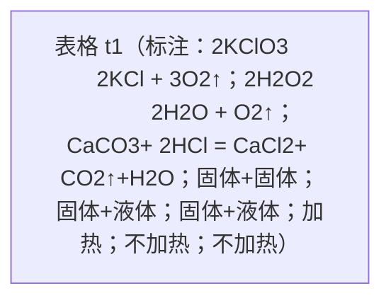
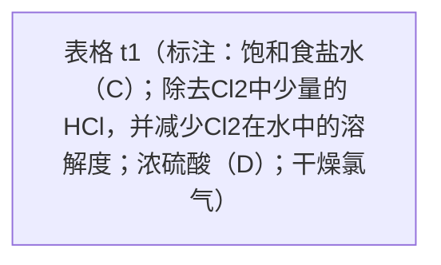
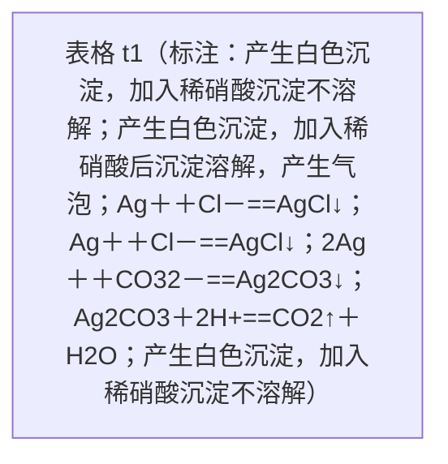

# 2.2.3氯气的实验室制法及氯离子的检验.pptx

共 17 页。每页“内容”为原生文字、表格和图表数据；“结构”只记录可确定的关系。

坐标单位为页面像素，原点在左上；页面右下为 1280,720。

## 第 1 页

### 内容

**c2**（左上 151,136；右下 1137,430）

第二章 海水中的重要元素——钠和氯

第二节  氯及其化合物

（第三课时）

**c1**（左上 396,518；右下 1215,578）

瑞昌一中高一年级化学备课组

## 第 2 页

### 内容

**c3**（左上 48,130；右下 324,227）

教学目标

**c2**（左上 78,268；右下 1040,564）

1.了解实验室制取氯气的原理。

2.了解实验室制取氯气实验装置。

**c1**（左上 64,641；右下 85,676）

作者编号：35005

## 第 3 页

### 内容

**c14**（左上 45,79；右下 661,154）

阅读P_(48)并思考如何制备氯气?

**c5**（左上 692,142；右下 863,290）

产生一种黄绿色、有刺激性气味的气体

**c4**（左上 436,142；右下 663,310）

将软锰矿（主要成分为MnO_(2)）与浓盐酸混合加热

**c6**（左上 905,162；右下 1006,256）

&#32;未能

&#32;确认

**c2**（左上 104,167；右下 212,260）

18世纪

70年代

**c3**（左上 257,171；右下 392,256）

瑞典化学家舍勒

**c12**（左上 155,285；右下 319,347）

30多年后

**c11**（左上 907,356；右下 1013,440）

确认为氯气

**c8**（左上 257,360；右下 392,445）

英国化学家戴维

**c9**（左上 438,362；右下 627,443）

重做上述实验

**c10**（左上 672,362；右下 861,443）

得出同样结果

**c7**（左上 104,370；右下 212,435）

1810年

**c13**（左上 373,557；右下 1095,632）

MnO_(2)＋4HCl(浓) === MnCl_(2)＋Cl_(2)↑＋2H_(2)O 

**c1**（左上 64,641；右下 85,676）

作者编号：35005

## 第 4 页

### 内容

**c2**（左上 43,73；右下 703,148）

一、氯气的实验室制法

**c3**（左上 43,134；右下 290,205）

【反应原理】

**c5**（左上 69,195；右下 1088,267）

实验室常用强氧化剂(如MnO_(2)、KMnO_(4)等)氧化浓盐酸等制氯气：

**c4**（左上 266,268；右下 938,340）

MnO_(2)＋4HCl(浓) === MnCl_(2)＋Cl_(2)↑＋2H_(2)O 

**c10**（左上 357,321；右下 579,379）

酸性、还原性

**c9**（左上 43,391；右下 980,469）

思考：（1） 可以用稀盐酸来代替浓盐酸制取氯气吗？

**c6**（左上 43,448；右下 1270,528）

不可以，因为稀盐酸的还原性比浓盐酸弱，稀盐酸不能被MnO_(2)氧化得到Cl_(2)。

**c8**（左上 43,506；右下 1243,643）

（2）使用浓盐酸与足量的MnO_(2)共热制Cl_(2)，实际产生的Cl_(2)总比理论值低，其主要原因是什么？

**c7**（左上 43,622；右下 1270,693）

稀盐酸与MnO_(2)不反应，随着反应的进行，浓盐酸的浓度逐渐变小。

**c1**（左上 64,641；右下 85,676）

作者编号：35005

## 第 5 页

### 内容

**c2**（左上 43,88；右下 290,159）

【实验装置】

**c3**（左上 53,144；右下 1211,228）

-   回顾初中所学的氧气、二氧化碳等气体的实验室制取方法，填入下表。

**t1**（左上 82,232；右下 1163,651） （4 行 × 5 列）

|  | C1 | C2 | C3 | C4 | C5 |
| --- | --- | --- | --- | --- | --- |
| R1 | 气体 | 制取原理（方程式） | 反应物状态 | 反应条件 | 装置图 |
| R2 | O2 |  |  |  | \u0020 |
| R3 | O2 |  |  |  | \u0020 |
| R4 | CO2 |  |  |  |  |

**c4**（左上 162,277；右下 649,346）

2KClO_(3             )2KCl + 3O_(2)↑

**c8**（左上 658,317；右下 855,386）

固体+固体

**c11**（左上 873,317；右下 979,386）

加热

**c5**（左上 162,335；右下 678,404）

2KMnO_(4            )K_(2)MnO_(4)+ MnO_(2)+ O_(2)↑

**c9**（左上 658,435；右下 877,500）

固体+液体

**c12**（左上 857,435；右下 1010,503）

不加热

**c6**（左上 202,435；右下 609,503）

2H_(2)O_(2             )2H_(2)O + O_(2)↑

**c7**（左上 174,535；右下 620,642）

CaCO_(3)+ 2HCl = CaCl_(2)+

CO_(2)↑+H_(2)O

**c13**（左上 857,549；右下 1010,617）

不加热

**c10**（左上 652,549；右下 855,617）

固体+液体

**c1**（左上 64,641；右下 85,676）

作者编号：35005

### 结构

## 第 6 页

### 内容

**c2**（左上 48,85；右下 295,156）

【实验装置】

**c9**（左上 291,154；右下 1012,228）

MnO_(2)＋4HCl(浓) === MnCl_(2)＋Cl_(2)↑＋2H_(2)O 

**c3**（左上 74,154；右下 578,226）

1\) 发生装置

**c6**（左上 372,203；右下 515,271）

加热

**c4**（左上 74,216；右下 684,447）

①类型：

②仪器：分液漏斗、圆底烧瓶

③试剂：

**c5**（左上 257,228；右下 416,296）

固+液

**c7**（左上 469,228；右下 621,296）

气体

**c10**（左上 868,373；右下 977,570）

√

**c8**（左上 210,374；右下 702,445）

A：浓盐酸    B：MnO_(2)

**c11**（左上 62,541；右下 1234,699）

发生装置中制得的Cl_(2)是纯净的氯气吗？如果不是，可能含有哪些杂质？应该如何除杂？

**c1**（左上 64,641；右下 85,676）

作者编号：35005

## 第 7 页

### 内容

**c2**（左上 27,108；右下 274,180）

【实验装置】

**c3**（左上 63,151；右下 567,222）

2)除杂装置

**t1**（左上 63,219；右下 1096,430） （3 行 × 3 列）

|  | C1 | C2 | C3 |
| --- | --- | --- | --- |
| R1 | 杂质气体 | 盛放的试剂 | 试剂的作用 |
| R2 | HCl |  | \n |
| R3 | H2O |  |  |

**c5**（左上 651,272；右下 1071,389）

除去Cl_(2)中少量的HCl，并减少Cl_(2)在水中的溶解度

**c4**（左上 270,292；右下 609,363）

饱和食盐水（C）

**c6**（左上 303,369；右下 576,441）

浓硫酸（D）

**c7**（左上 762,369；右下 992,441）

干燥氯气

**c8**（左上 63,513；右下 763,584）

除杂装置中的试剂的顺序是否可以颠倒？

**c1**（左上 64,641；右下 85,676）

作者编号：35005

### 结构

## 第 8 页

### 内容

**c13**（左上 717,48；右下 1522,175）

已知：1.Cl_(2) 有毒，且密度比空气大

2.Cl_(2)能溶于水，难溶于饱和食盐水

**c2**（左上 43,88；右下 290,159）

【实验装置】

**c3**（左上 58,145；右下 561,234）

3)收集装置

**c4**（左上 95,220；右下 400,308）

①收集方法：

**c12**（左上 576,266；右下 686,464）

√

**c5**（左上 126,280；右下 370,369）

向上排空法

**c9**（左上 366,360；右下 551,428）

①排水法

**c10**（左上 572,360；右下 840,428）

②向上排空气法

**c11**（左上 862,360；右下 1128,428）

③向下排空气法

**c6**（左上 95,427；右下 400,515）

②验满方法：

**c16**（左上 1018,453；右下 1128,650）

√

**c7**（左上 101,482；右下 514,629）

A、湿润的淀粉-KI试纸放在集气瓶口

**c15**（左上 548,595；右下 812,663）

排饱和食盐水法

**c14**（左上 864,613；右下 1048,671）

饱和食盐水

**c8**（左上 101,618；右下 509,706）

B、湿润的蓝色石蕊试纸

**c1**（左上 64,641；右下 85,676）

作者编号：35005

## 第 9 页

### 内容

**c2**（左上 195,112；右下 454,177）

什么作用？

**c3**（左上 621,154；右下 868,226）

【实验装置】

**c4**（左上 639,208；右下 1143,296）

4)尾气处理装置

**c5**（左上 663,300；右下 1258,372）

烧杯中盛装NaOH溶液的作用：

**c6**（左上 601,372；右下 1173,444）

2NaOH+Cl_(2)=NaClO+NaCl+H_(2)O

**c7**（左上 676,451；右下 1143,598）

作用：吸收过量的氯气，

&#32;&#32;&#32;&#32;&#32;&#32;&#32;&#32;&#32;&#32;&#32;&#32;&#32;&#32;&#32;防止污染空气。

**c8**（左上 51,469；右下 855,596）

已知：

1.Cl_(2)有毒

**c11**（左上 383,527；右下 582,596）

会污染空气

**c10**（左上 50,576；右下 409,644）

2.Cl_(2)不能燃烧

**c9**（左上 51,624；右下 789,692）

3.Cl_(2)能与NaOH溶液反应，生成能溶于水的物质

**c1**（左上 64,641；右下 85,676）

作者编号：35005

## 第 10 页

### 内容

**c3**（左上 330,59；右下 648,156）

仪器组装顺序：

自下而上、从左到右

**c4**（左上 917,78；右下 1223,214）

注意导气管的进出方式（长进短出）

为什么？

**c5**（左上 965,278；右下 1275,413）

尾气处理时，能用澄清石灰水吸收氯气吗？

**c2**（左上 88,562；右下 1219,690）

&#32;&#32;&#32;&#32;&#32;&#32;&#32;尾气处理时，不能用澄清石灰水吸收氯气，因为澄清石灰水中Ca(OH)_(2)的含量少，吸收不完全。

**c1**（左上 64,641；右下 85,676）

作者编号：35005

## 第 11 页

### 内容

**c2**（左上 45,79；右下 1130,154）

阅读P_(49)方法导引.并总结设计气体制备装置的基本思路

**c1**（左上 64,641；右下 85,676）

作者编号：35005

## 第 12 页

### 内容

**c3**（左上 31,95；右下 1227,175）

1.某同学用下列装置制备并检验Cl_(2)的性质。下列说法正确的是(      )

**c4**（左上 919,99；右下 988,183）

D

**c2**（左上 38,394；右下 1249,703）

A.Ⅰ图中：如果MnO_(2)过量，盐酸就可全部消耗

B.Ⅱ图中：如果倒置的量筒充满了氯气，水槽内装满水，经足够长的时间光照，量筒内最后剩余气体为HCl和氧气

C.Ⅲ图中：生成蓝色的烟

D.Ⅳ图中：b能褪色，反应后将硫酸溶液滴入烧杯中至溶液呈酸性，结果有Cl_(2)生成

**c1**（左上 64,641；右下 85,676）

作者编号：35005

## 第 13 页

### 内容

**c2**（左上 43,88；右下 221,159）

【拓展】

**c3**（左上 72,164；右下 946,233）

思考：可以用其他氧化剂、还原剂来代替MnO_(2)、浓HCl吗？

**c4**（左上 90,219；右下 1242,287）

KMnO_(4)、 KClO_(3) 、Ca(ClO) _(2)等代替MnO_(2；)浓HCl用浓H_(2)SO_(4)和NaCl固体代替

**c5**（左上 94,265；右下 1259,630）

拓展：实验室制氯气的其它方法：

① 16HCl＋2KMnO_(4) === 2KCl＋2MnCl_(2)＋8H_(2)O＋5Cl_(2)↑

② 6HCl(浓)＋KClO_(3) === KCl＋3H_(2)O＋3Cl_(2)↑

③ 4HCl＋Ca(ClO)_(2) === CaCl_(2)＋2H_(2)O＋2Cl_(2)↑

- 1 工业制取Cl_(2)：用电解饱和食盐水的方法，反应的化学方程式为：

&#32;&#32;&#32;&#32;&#32;&#32;&#32;2NaCl＋2H_(2)O === 2NaOH＋H_(2)↑＋Cl_(2)↑。

**c1**（左上 64,641；右下 85,676）

作者编号：35005

## 第 14 页

### 内容

**c2**（左上 37,61；右下 914,164）

阅读P_(49 )三、氯离子的检验及实验2-9并思考：

**c3**（左上 92,146；右下 1175,427）

1、检验氯离子需要什么试剂？检验原理是什么？

2、检验氯离子硝酸的作用是什么？硝酸能换成盐酸或稀硫酸吗？

3、叙述氯离子的检验方法。

**c4**（左上 16,386；右下 573,473）

氯离子的检验

**c5**（左上 43,495；右下 1237,671）

【实验2-9】在三支试管中分别加入2\~3 mL稀盐酸、NaCl溶液、Na_(2)CO_(3)溶液，然后各滴入几滴AgNO_(3)溶液，观察现象。再分别加入少量稀硝酸，观察现象。

**c1**（左上 64,641；右下 85,676）

作者编号：35005

## 第 15 页

### 内容

**t1**（左上 67,106；右下 1235,588） （4 行 × 3 列）

|  | C1 | C2 | C3 |
| --- | --- | --- | --- |
| R1 | 实验试剂 | 实验现象 | 实验原理 |
| R2 | 稀盐酸 |  |  |
| R3 | NaCl溶液 |  |  |
| R4 | Na2CO3溶液 |  |  |

**c2**（左上 311,176；右下 737,309）

产生白色沉淀，加入稀硝酸沉淀不溶解

**c4**（左上 821,207；右下 1246,282）

Ag^(＋)＋Cl^(－)==AgCl↓

**c8**（左上 311,305；右下 737,439）

产生白色沉淀，加入稀硝酸沉淀不溶解

**c5**（左上 821,338；右下 1214,413）

Ag^(＋)＋Cl^(－)==AgCl↓

**c6**（左上 782,439；右下 1277,514）

2Ag^(＋)＋CO_(3)^(2－)==Ag_(2)CO_(3)↓

**c3**（左上 305,446；右下 767,580）

产生白色沉淀，加入稀硝酸后沉淀溶解，产生气泡

**c7**（左上 765,502；右下 1289,577）

Ag_(2)CO_(3)＋2H^(+)==CO_(2)↑＋H_(2)O

**c9**（左上 67,596；右下 1235,720）

实验结论：CO_(3)^(2-)的存在会对Cl^(-)的检验造成干扰，因此在检验Cl^(-)时，一般先加入适量稀硝酸，然后再滴加AgNO_(3)溶液。

**c1**（左上 64,641；右下 85,676）

作者编号：35005

### 结构

## 第 16 页

### 内容

**c8**（左上 20,61；右下 577,149）

氯离子的检验

**c3**（左上 53,149；右下 253,224）

1、试剂：

**c9**（左上 208,149；右下 638,224）

稀硝酸和AgNO_(3)溶液

**c4**（左上 642,149；右下 911,224）

原理：

**c11**（左上 760,150；右下 1186,225）

Ag^(＋)＋Cl^(－)==AgCl↓

**c5**（左上 53,223；右下 370,298）

2、硝酸的作用：

**c10**（左上 331,223；右下 991,298）

排除CO_(3)^(2-)的干扰

**c2**（左上 104,298；右下 1312,441）

不能。稀盐酸酸化，引入Cl^(-)，也会产生白色沉淀，对实验造成干扰。

稀硫酸酸化，引入SO_(4)^(2-)，会产生白色的硫酸银沉淀，对实验造成干扰。

**c7**（左上 531,461；右下 1244,626）

取少量待测液于试管中滴入适量稀硝酸酸化，再滴入AgNO_(3)溶液若产生白色沉淀则证明待测液中含有Cl^(-)。

**c6**（左上 64,468；右下 724,543）

3、氯离子的检验方法：

**c1**（左上 64,641；右下 85,676）

作者编号：35005

## 第 17 页

### 内容

**c2**（左上 42,71；右下 1244,702）

1.下列检验Cl^(－)的方法正确的是（         ）

&#32;&#32;A.向某溶液中滴加AgNO_(3)溶液，若产生白色沉淀说明该溶液中有Cl^(－)

&#32;&#32;B.向某溶液中先滴加盐酸，再滴加AgNO_(3)溶液，若产生白色沉淀，说

&#32;&#32;&#32;&#32;&#32;明溶液中有Cl^(－)

&#32;C.向某溶液中先滴加AgNO_(3)溶液，产生白色沉淀，再滴加盐酸，沉淀

&#32;&#32;&#32;&#32;不消失，说明溶液中有Cl^(－)

&#32;D.向某溶液中滴加用HNO_(3)酸化的AgNO_(3)溶液，若产生白色沉淀，说

&#32;&#32;&#32;&#32;&#32;明溶液中有Cl^(－)

**c3**（左上 611,91；右下 689,167）

D

**c1**（左上 64,641；右下 85,676）

作者编号：35005
